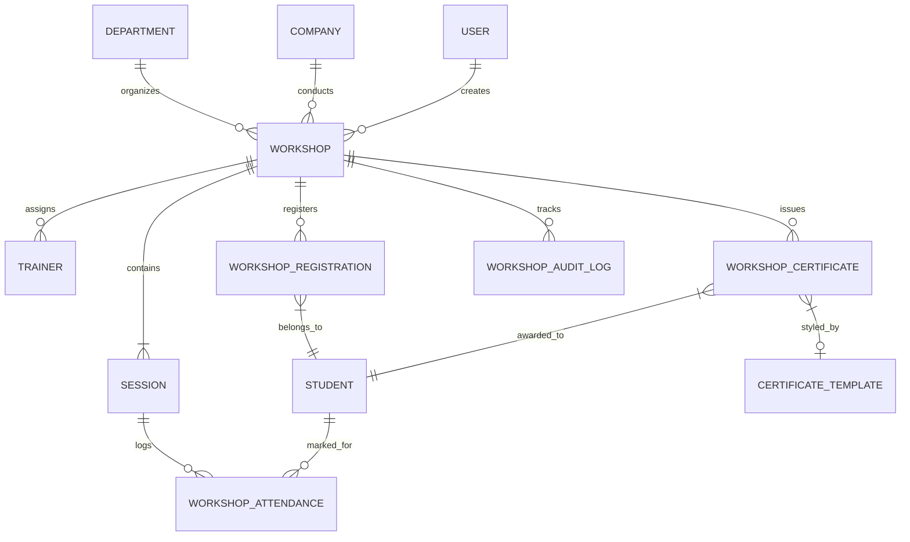
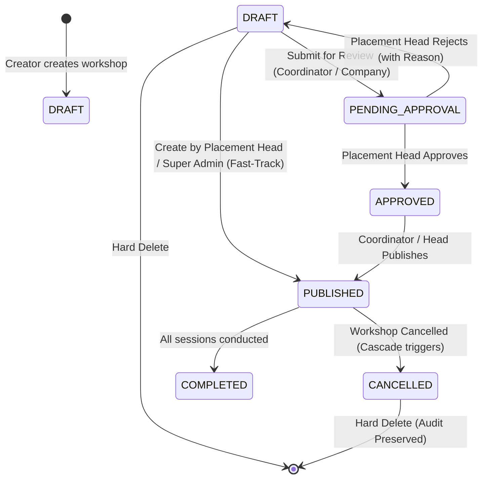
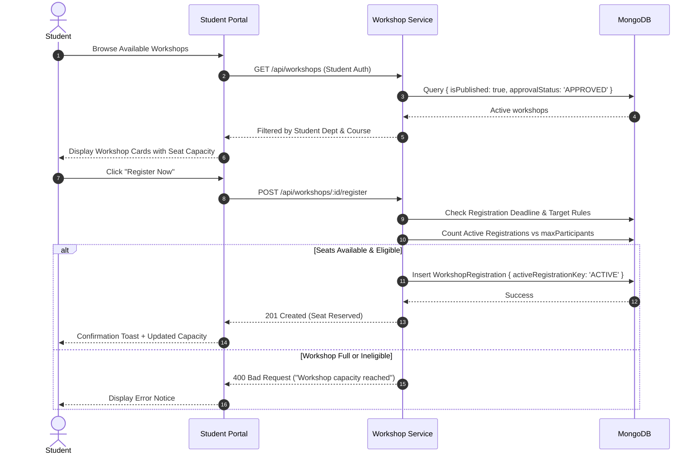
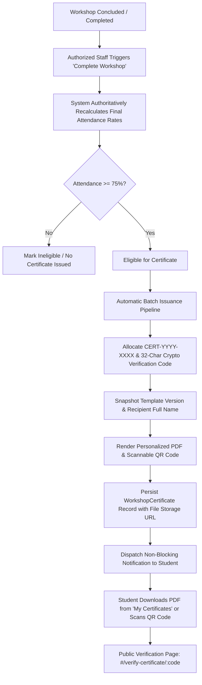

# Training & Workshops Module — Comprehensive Technical & Architecture Report

> **System**: VVWU Campus Recruitment Portal  
> **Module**: Training & Workshops Management System  
> **Target Audience**: System Architects, Developers, Placement Officers, and Academic Administrators  
> **Document Version**: 2.0  
> **Generated**: October 2026  

---

## Table of Contents
1. [Executive Summary & Purpose](#1-executive-summary--purpose)
2. [High-Level Architecture & Entity Relationships](#2-high-level-architecture--entity-relationships)
3. [Data Models & Schema Specifications](#3-data-models--schema-specifications)
   - [Workshop Model & Subdocuments](#31-workshop-model--subdocuments)
   - [Workshop Registration Model](#32-workshop-registration-model)
   - [Workshop Attendance Model](#33-workshop-attendance-model)
   - [Workshop Certificate & Template Models](#34-workshop-certificate--template-models)
   - [Workshop Audit Log Model](#35-workshop-audit-log-model)
4. [User Types & Granular Role-Based Access Control (RBAC)](#4-user-types--granular-role-based-access-control-rbac)
   - [Detailed Access Matrix by User Role](#41-detailed-access-matrix-by-user-role)
   - [Role-Specific Scoping & Boundaries](#42-role-specific-scoping--boundaries)
5. [End-to-End Workflow & Lifecycle State Machines](#5-end-to-end-workflow--lifecycle-state-machines)
   - [Workshop Curriculum & Approval Lifecycle](#51-workshop-curriculum--approval-lifecycle)
   - [Student Discovery, Eligibility & Registration Flow](#52-student-discovery-eligibility--registration-flow)
   - [Session Attendance Tracking & 75% Rule Calculation](#53-session-attendance-tracking--75-rule-calculation)
   - [Certificate Issuance, PDF Rendering & Public Verification](#54-certificate-issuance-pdf-rendering--public-verification)
   - [Cancellation Cascade & Data Integrity](#55-cancellation-cascade--data-integrity)
6. [API Route Reference & Security Endpoints](#6-api-route-reference--security-endpoints)
7. [Frontend Architecture & UI Components](#7-frontend-architecture--ui-components)
8. [Key Technical Guarantees & Constraints](#8-key-technical-guarantees--constraints)

---

## 1. Executive Summary & Purpose

The **Training & Workshops Module** is an enterprise-grade component of the VVWU Campus Recruitment Portal. It bridges the gap between academic preparation and corporate recruitment by providing an end-to-end management pipeline for skill development bootcamps, technical training, industry workshops, and student certifications.

### Core Objectives
1. **Centralized Program Management**: Enable both university placement officers and corporate recruitment partners to design, organize, and administer multi-session skill workshops.
2. **Flexible Audience Targeting**: Allow workshops to target specific departments, academic courses, semesters, or open campus-wide.
3. **Rigorous Multi-Session Attendance**: Track attendance down to individual sessions and enforce a 75% attendance rule for certificate eligibility.
4. **Digital Credentialing & Fraud Prevention**: Automatically generate verifiable digital certificates with unique alphanumeric serial numbers, cryptographic hashes, and public QR verification links.
5. **Auditable Lifecycle Governance**: Provide a complete audit trail for state changes (draft, approval, publish, cancel, attendance modification, certificate issuance/revocation).

---

## 2. High-Level Architecture & Entity Relationships

The module is built on a full-stack MERN (MongoDB, Express, React, Node.js) architecture with role-based middleware, optimistic capacity locks, and audit hooks.



### Core Subsystems
- **Workshop Engine**: Handles workshop creation, validation, sequential ID issuance (`WS-YYYY-XXXX`), and immutable state transitions.
- **Audience & Targeting Filter**: Dynamically matches student academic attributes (department, branch, semester) against workshop criteria.
- **Registration & Capacity Manager**: Prevents double-booking and enforces seat capacities under concurrent requests.
- **Attendance & Eligibility Engine**: Analyzes multi-session attendance logs and flags students as `ELIGIBLE` or `INELIGIBLE` for certification.
- **Certificate & Verification Engine**: Produces vector-rendered PDF certificates with dynamic signatures, backgrounds, and public QR verification endpoints.

---

## 3. Data Models & Schema Specifications

### 3.1 Workshop Model & Subdocuments
*File: `backend/src/models/workshop.model.js`*

```javascript
{
  workshopId: { type: String, unique: true },        // Generated as "WS-YYYY-XXXX"
  title: { type: String, required: true },
  description: { type: String, required: true },
  category: { 
    type: String, 
    enum: ['TECHNICAL', 'APTITUDE', 'SOFT_SKILLS', 'INTERVIEW_PREP', 'CAREER_GUIDANCE', 'OTHER'] 
  },
  mode: { type: String, enum: ['ONLINE', 'OFFLINE', 'HYBRID'], required: true },
  venue: { type: String },                           // Physical venue (campus lab, hall)
  meetingLink: { type: String },                     // Online meeting URL (Google Meet / Zoom)
  maxParticipants: { type: Number, min: 1 },
  startAt: { type: Date, required: true },
  endAt: { type: Date, required: true },
  registrationOpensAt: { type: Date, default: Date.now },
  registrationDeadline: { type: Date, required: true },
  
  // Ownership & Scope
  ownershipType: { 
    type: String, 
    enum: ['DEPARTMENT', 'CENTRAL_PLACEMENT_CELL'], 
    default: 'DEPARTMENT' 
  },
  departmentId: { type: Schema.Types.ObjectId, ref: 'Department' },
  companyId: { type: Schema.Types.ObjectId, ref: 'Company' },
  createdBy: { type: Schema.Types.ObjectId, ref: 'User', required: true },
  
  // Target Audience Configuration
  targetAudience: {
    isAllDepartments: { type: Boolean, default: false },
    departmentRules: [{
      departmentId: { type: Schema.Types.ObjectId, ref: 'Department' },
      targetingMode: { 
        type: String, 
        enum: ['ALL_COURSES_ALL_SEMESTERS', 'SELECTED_COURSES_ALL_SEMESTERS', 'CUSTOM'] 
      },
      courseIds: [{ type: Schema.Types.ObjectId, ref: 'Course' }]
    }]
  },
  
  // Instructors Subdocuments
  trainers: [{
    trainerType: { type: String, enum: ['INTERNAL_FACULTY', 'EXTERNAL', 'COMPANY', 'PLACEMENT_COORDINATOR', 'PLACEMENT_HEAD'] },
    name: { type: String, required: true },
    designation: { type: String },
    organization: { type: String },
    companyId: { type: Schema.Types.ObjectId, ref: 'Company' },
    userId: { type: Schema.Types.ObjectId, ref: 'User' }
  }],
  
  // Sessions Subdocuments
  sessions: [{
    sessionId: { type: String, required: true },     // "SES-01", "SES-02", etc.
    sessionNumber: { type: Number, required: true },  // 1, 2, ...
    title: { type: String, required: true },
    startAt: { type: Date, required: true },
    endAt: { type: Date, required: true },
    trainerIds: [{ type: Schema.Types.ObjectId }],
    isAttendanceRequired: { type: Boolean, default: true }
  }],
  
  // Status & Governance
  approvalStatus: { 
    type: String, 
    enum: ['DRAFT', 'PENDING_APPROVAL', 'APPROVED', 'REJECTED'], 
    default: 'DRAFT' 
  },
  lifecycleStatus: { 
    type: String, 
    enum: ['SCHEDULED', 'IN_PROGRESS', 'COMPLETED', 'CANCELLED'], 
    default: 'SCHEDULED' 
  },
  isPublished: { type: Boolean, default: false },
  certificateTemplateId: { type: Schema.Types.ObjectId, ref: 'WorkshopCertificateTemplate' }
}
```

#### Key Model Constraints:
1. **Sequential ID Issuance**: Automatically allocates IDs formatted as `WS-<IST_YEAR>-<4_DIGIT_SEQ>` (e.g., `WS-2026-0012`) atomically during creation.
2. **Session Boundaries Validation**: Pre-save hooks verify that every session's `startAt` and `endAt` lie strictly between the workshop's overall `startAt` and `endAt`.
3. **Immutability Protection**: Once a workshop is published (`isPublished: true`), core parameters (`mode`, `startAt`, `endAt`, `ownershipType`, `departmentId`, `targetingScope`, `sessions`) are strictly immutable to maintain integrity for enrolled students.

---

### 3.2 Workshop Registration Model
*File: `backend/src/models/workshop_registration.model.js`*

Manages student enrollment, seat occupancy, and cancellation cascades.

```javascript
{
  workshopId: { type: Schema.Types.ObjectId, ref: 'Workshop', required: true, index: true },
  studentId: { type: Schema.Types.ObjectId, ref: 'Student', required: true, index: true },
  status: { 
    type: String, 
    enum: ['REGISTERED', 'CANCELLED', 'ATTENDED', 'COMPLETED', 'ABSENT'], 
    default: 'REGISTERED' 
  },
  registeredAt: { type: Date, default: Date.now },
  cancelledAt: { type: Date },
  cancellationReason: { type: String },
  activeRegistrationKey: { type: String, default: 'ACTIVE' }
}
```

#### Compound Index & Concurrency:
- **Index**: `{ workshopId: 1, studentId: 1, activeRegistrationKey: 1 }` with `{ unique: true }`.
- When a registration is cancelled, `activeRegistrationKey` is cleared to `null`, allowing the student to re-register if seats reopen while preventing simultaneous active registrations.

---

### 3.3 Workshop Attendance Model
*File: `backend/src/models/workshop_attendance.model.js`*

Tracks student attendance on a per-session granularity.

```javascript
{
  workshopId: { type: Schema.Types.ObjectId, ref: 'Workshop', required: true, index: true },
  sessionId: { type: String, required: true, index: true }, // "SES-01"
  studentId: { type: Schema.Types.ObjectId, ref: 'Student', required: true, index: true },
  status: { 
    type: String, 
    enum: ['PRESENT', 'ABSENT'], 
    required: true 
  },
  markedBy: { type: Schema.Types.ObjectId, ref: 'User', required: true },
  markedAt: { type: Date, default: Date.now },
  remarks: { type: String }
}
```

- **Compound Unique Index**: `{ workshopId: 1, sessionId: 1, studentId: 1 }` guarantees only one attendance entry per student per session.
- **Correction Support**: Trainers or administrators can update existing records with audit timestamps.

---

### 3.4 Workshop Certificate & Template Models
*Files: `backend/src/models/workshop_certificate.model.js` & `workshop_certificate_template.model.js`*

```javascript
// WorkshopCertificate
{
  workshopId: { type: Schema.Types.ObjectId, ref: 'Workshop', required: true },
  studentId: { type: Schema.Types.ObjectId, ref: 'Student', required: true },
  certificateNumber: { type: String, unique: true }, // "CERT-2026-0001"
  verificationCode: { type: String, unique: true },  // High-entropy UUID
  verificationHash: { type: String, required: true },// SHA-256 integrity hash
  issuedAt: { type: Date, default: Date.now },
  status: { type: String, enum: ['ISSUED', 'REVOKED'], default: 'ISSUED' },
  revokedAt: { type: Date },
  revokedReason: { type: String },
  attendancePercentage: { type: Number, min: 0, max: 100 }
}
```

```javascript
// WorkshopCertificateTemplate
{
  name: { type: String, required: true },
  description: { type: String },
  companyId: { type: Schema.Types.ObjectId, ref: 'Company' }, // Optional (for company-branded certificates)
  isDefault: { type: Boolean, default: false },
  backgroundImageUrl: { type: String },                       // Custom certificate border / background
  signatoryTitle: { type: String, default: 'Head - Training & Placements' },
  signatoryName: { type: String, default: 'Placement Officer' },
  signatureImageUrl: { type: String },
  institutionName: { type: String, default: 'Vanita Vishram Women\'s University' }
}
```

---

### 3.5 Workshop Audit Log Model
*File: `backend/src/models/workshop_audit_log.model.js`*

Provides an immutable trail for security, compliance, and accreditation bodies (e.g., NAAC / NBA).

```javascript
{
  workshopId: { type: Schema.Types.ObjectId, ref: 'Workshop', required: true, index: true },
  action: { 
    type: String, 
    enum: [
      'WORKSHOP_CREATED', 'WORKSHOP_UPDATED', 'WORKSHOP_SUBMITTED', 
      'WORKSHOP_APPROVED', 'WORKSHOP_REJECTED', 'WORKSHOP_PUBLISHED', 
      'WORKSHOP_CANCELLED', 'WORKSHOP_DELETED', 'ATTENDANCE_MARKED', 
      'ATTENDANCE_CORRECTED', 'CERTIFICATES_ISSUED', 'CERTIFICATE_REVOKED'
    ],
    required: true 
  },
  performedBy: { type: Schema.Types.ObjectId, ref: 'User', required: true },
  details: { type: Schema.Types.Mixed },
  performedAt: { type: Date, default: Date.now }
}
```

---

## 4. User Types & Granular Role-Based Access Control (RBAC)

The system enforces strict permission checks at the API middleware level via `authenticate` and `authorizePermissions(PERMISSION_IDS.*)`.

### 4.1 Detailed Access Matrix by User Role

| Functionality / Action | Super Admin | Placement Head | Placement Coordinator | Company Recruiter / Trainer | Student | Public / Guest |
| :--- | :---: | :---: | :---: | :---: | :---: | :---: |
| **Browse Published Workshops** | Yes | Yes | Yes | Yes (Own only) | Yes (Targeted only) | No |
| **View Sessions Count in Table** | Yes | Yes | Yes | Yes | N/A (Card View) | No |
| **Create New Workshop** | Yes | Yes | Yes (Own Dept only) | Yes (Own Company only) | No | No |
| **Auto-Publish (Skip Approval)** | Yes | Yes | No (Requires Approval) | No (Requires Approval) | No | No |
| **Approve / Reject Workshops** | Yes | Yes | No | No | No | No |
| **Publish Approved Workshop** | Yes | Yes | Yes (Own Dept only) | No (Head Publishes) | No | No |
| **Edit Draft Workshop** | Yes | Yes | Yes (Own Dept only) | Yes (Own Company only) | No | No |
| **Cancel Published Workshop** | Yes | Yes | Yes (Own Dept only) | Yes (Own Company only) | No | No |
| **Delete Draft/Cancelled Workshop**| Yes | Yes | Yes (Own Dept only) | Yes (Own Company only) | No | No |
| **Register for Workshop Seat** | No | No | No | No | Yes (Self only) | No |
| **Cancel Own Seat Booking** | No | No | No | No | Yes (Self only) | No |
| **View Participant Roster** | Yes | Yes | Yes (Own Dept only) | Yes (Own Company only) | No | No |
| **Mark / Correct Attendance** | Yes | Yes | Yes (Own Dept only) | Yes (Assigned Sessions) | No | No |
| **Issue Verified Certificates** | Yes | Yes | No | No | No | No |
| **Revoke Issued Certificate** | Yes | Yes | No | No | No | No |
| **Download Certificate PDF** | Yes | Yes | Yes | Yes | Yes (Own only) | No |
| **Verify Certificate (QR Code)** | Yes | Yes | Yes | Yes | Yes | Yes (Unauthenticated)|
| **Upload Certificate Templates** | Yes | Yes | No | Yes (Company Scope) | No | No |
| **Inspect Immutable Audit Trail** | Yes | Yes | Yes (Own Dept only) | Yes (Own Company only) | No | No |

---

### 4.2 Role-Specific Scoping & Boundaries

#### 1. Student (`ROLE_STUDENT` / `userType === 'STUDENT'`)
- **Visibility Firewall**: Students **only see** workshops that meet three conditions:
  1. `isPublished: true`
  2. `approvalStatus: 'APPROVED'`
  3. `lifecycleStatus !== 'CANCELLED'`
  4. The workshop targets their specific department, course, or semester (or is open campus-wide).
- **Seat Registration**: Allowed only when `seatsRemaining > 0` and current time is before `registrationDeadline`.
- **Certificates**: Has access to a personal "My Certificates" dashboard to view and download earned credentials.

#### 2. Company Recruiter (`ROLE_COMPANY` / `userType === 'COMPANY'`)
- **Company-Bound Scope**: Can only view and create workshops where `companyId` matches their authenticated company profile.
- **Workflow Restriction**: Created workshops start in `DRAFT`. The recruiter must submit the workshop for review. **Company users cannot self-approve or self-publish workshops**.
- **Attendance Authority**: Recruiter/trainers can log in to view the enrolled student roster and mark attendance for sessions where their trainers are assigned.
- **Templates**: Can upload custom company-branded certificate templates (company logo, border graphics).

#### 3. Placement Coordinator (`ROLE_PLACEMENT_COORDINATOR`)
- **Department-Bound Scope**: Scoped exclusively to their assigned academic department (e.g., Computer Science).
- **Creation Rule**: Can create workshops under their department (`ownershipType: 'DEPARTMENT'`).
- **Submission Requirement**: Coordinator workshops must be submitted to the Placement Head for institutional approval (`PENDING_APPROVAL`).
- **Publishing Right**: Once approved by the Placement Head, coordinators have permission to publish their department workshop.
- **Operational Scope**: Can record session attendance, export student rosters, and monitor registrations for their department.

#### 4. Placement Head (`ROLE_PLACEMENT_HEAD`)
- **Institutional Governance**: Full institutional oversight across all university departments and company programs.
- **Fast-Track Auto-Publish**: Workshops created by the Placement Head or Central Placement Cell automatically transition to `APPROVED` and `PUBLISHED` without needing external review.
- **Approval Queue Authority**: Evaluates, approves, or rejects pending workshops submitted by Coordinators and Companies with mandatory remarks.
- **Sole Credentialing Authority**: Can trigger batch certificate generation, inspect student eligibility (75% rule), and revoke certificates if misconduct is detected.

#### 5. Super Admin (`ROLE_SUPER_ADMIN`)
- **Unrestricted Access**: Possesses all 57 canonical system permissions. Can manage templates, bypass constraints, override statuses, inspect raw audit trails, and manage system users.

---

## 5. End-to-End Workflow & Lifecycle State Machines

### 5.1 Workshop Curriculum & Approval Lifecycle



1. **Draft Phase**: Workshop curriculum, schedule, trainers, sessions (`SES-01`, `SES-02`), and capacity are drafted in a 5-step modal.
2. **Review & Approval Queue**:
   - Company & Coordinator drafts appear in the Placement Head's **Approval Queue**.
   - Approvals require confirmation; rejections require entering a justification reason stored in the audit log.
3. **Publication**: Publishing locks structural fields and makes the workshop visible to targeted students.

---

### 5.2 Student Discovery, Eligibility & Registration Flow



---

### 5.3 Session Attendance Tracking & 75% Rule Calculation

Attendance is calculated across all sessions marked with `isAttendanceRequired: true`.

#### The 75% Attendance Algorithm:
1. **Total Required Sessions ($S_{req}$)**: Total count of sessions where `isAttendanceRequired === true`. If no sessions are explicitly marked required, all workshop sessions are treated as required.
2. **Attended Sessions ($S_{att}$)**: Total sessions where the student's status is strictly `PRESENT`. `EXCUSED` status has been completely removed from backend enums, request validation, frontend forms, and eligibility calculations.
3. **Attendance Rate ($A$)**:
   $$A = \left( \frac{S_{att}}{S_{req}} \right) \times 100$$
4. **Certification Eligibility**:
   $$\text{Eligible} = \begin{cases} \text{True} & \text{if } A \ge 75\% \\ \text{False} & \text{if } A < 75\% \end{cases}$$

---

### 5.4 Certificate Lifecycle, PDF Rendering & Public Verification



#### Key Architecture Principles:
1. **Configure Once per Workshop**: Creators configure template during workshop authoring or editing (Company template, Department template, or Default Institutional VVWU Design).
2. **Authoritative 75% Attendance Gate**:
   - Strictly binary attendance: `PRESENT` and `ABSENT`. `EXCUSED` is not supported.
   - Missing required-session attendance counts as absent.
   - Zero required sessions explicitly handled (0% attendance, no divide-by-zero, certificates blocked).
3. **Automatic Issuance on Completion Transition**:
   - Transitioning workshop `lifecycleStatus` to `COMPLETED` via `POST /api/workshops/:id/complete` authoritatively calculates student attendance and automatically issues certificates for all eligible candidates.
   - Manual batch issuance or retry via `POST /api/workshops/:id/certificates/issue` is also available to Placement Head & Super Admin.
4. **Idempotency & Concurrency Protection**:
   - Compound unique index on `{ workshopId: 1, studentId: 1 }` prevents duplicate records.
   - Retries skip already-issued certificates and resume incomplete ones safely.
5. **Template Versioning & Snapshot Immutability**:
   - Material changes to a template bump its `version` if certificates have already been issued.
   - Each certificate record stores an immutable `templateSnapshot` and `templateVersion`. Past issued PDFs are never regenerated or corrupted by future template edits.
6. **Student My Certificates & Secure Downloads**:
   - Students securely view and download certificates at `#/certificates` via `GET /api/workshops/certificates/me`.
   - Download endpoint `GET /api/workshops/certificates/:id/download` enforces strict ownership: students can only download their own certificates; cross-student downloads are blocked with 403.
   - Revoked certificates are rejected with 400 (`CERTIFICATE_REVOKED`).
7. **Public QR Verification & Data Minimization**:
   - Public route `GET /api/workshops/certificates/verify/:code` validates authenticity without authentication.
   - Applies strict data minimization: returns only student initials (e.g. "Priya S."), workshop title, issue date, status, and revocation details. Excludes internal file paths, student IDs, and emails.
8. **Revocation & Audit Logging**:
   - Placement Head and Super Admin can revoke certificates with a mandatory reason (`POST /api/workshops/certificates/:id/revoke`).
   - Dispatches real-time notification to the student and records audit log.
9. **Deployment & Storage Considerations**:
   - Certificates are stored in persistent directory `public/uploads/certificates`.
   - In multi-instance / cloud clusters, shared network storage (e.g., AWS S3 / Cloud Storage adapter) should be mounted for horizontal scalability.

---

### 5.5 Cancellation Cascade & Data Integrity

When a workshop is cancelled via `POST /api/workshops/:id/cancel`:
1. Workshop `lifecycleStatus` transitions to `CANCELLED`, `isPublished` is set to `false`, and `cancellationReason` is recorded directly on the document.
2. The workshop document is preserved in the database to maintain full auditability, historical compliance, and reporting; cancellation is strictly distinct from hard deletion (`DELETE /api/workshops/:id`).
3. Cancelled workshops are automatically excluded from normal active and upcoming listings unless explicitly queried via `lifecycleStatus=CANCELLED` or `includeCancelled=true`.
4. All active student registrations (`status: 'REGISTERED'`) are cascaded to `status: 'CANCELLED'` with `activeRegistrationKey` unset, freeing capacity without destroying historical records.
5. Previously issued certificates remain valid and verifiable.
6. A transactional audit log entry (`WORKSHOP_CANCELLED`) records the actor, timestamp, cancellation rationale, and affected registrations.

---

## 6. API Route Reference & Security Endpoints

*Base URL: `/api/workshops`*

| Method | Endpoint | Required Permission | Allowed Roles | Description |
| :--- | :--- | :--- | :--- | :--- |
| **GET** | `/certificates/verify/:code` | *None (Public)* | Anyone | Public QR-code certificate verification endpoint |
| **GET** | `/certificates/me` | `WORKSHOP_READ` | Student | List authenticated student's earned certificates |
| **GET** | `/certificates/:id/download` | Authenticated | Student / Staff | Download official certificate PDF |
| **POST**| `/certificates/:id/revoke` | `WORKSHOP_CERTIFICATE_MANAGE` | Head, Admin | Revoke certificate with reason |
| **GET** | `/templates` | Authenticated | Head, Admin, Company | List certificate styling templates |
| **POST**| `/templates` | Authenticated | Head, Admin, Company | Upload background image and create template |
| **GET** | `/` | `WORKSHOP_READ` | All authenticated | List/search workshops with role-based scoping |
| **POST**| `/` | `WORKSHOP_CREATE` | Head, Admin, Coord, Company | Create new workshop draft |
| **GET** | `/:id` | `WORKSHOP_READ` | All authenticated | Get detailed workshop profile & curriculum |
| **PATCH`| `/:id` | `WORKSHOP_UPDATE` | Head, Admin, Coord, Company | Update draft or editable workshop fields |
| **DELETE**|`/:id` | `WORKSHOP_DELETE` | Head, Admin, Coord, Company | Delete draft or cancelled workshop |
| **POST**| `/:id/submit` | `WORKSHOP_UPDATE` | Coord, Company | Submit draft to Placement Head approval queue |
| **POST**| `/:id/approve` | `WORKSHOP_APPROVE` | Head, Super Admin | Approve pending workshop for publication |
| **POST**| `/:id/reject` | `WORKSHOP_APPROVE` | Head, Super Admin | Reject pending workshop with remarks |
| **POST**| `/:id/publish` | `WORKSHOP_PUBLISH` | Head, Admin, Coord (Own) | Publish approved workshop to students |
| **POST**| `/:id/cancel` | `WORKSHOP_CANCEL` | Head, Admin, Coord, Company | Cancel workshop & trigger registration cascade |
| **POST**| `/:id/register` | `WORKSHOP_REGISTER` | Student | Register student seat for workshop |
| **POST**| `/:id/cancel-registration`|`WORKSHOP_REGISTER` | Student | Cancel student's own seat reservation |
| **GET** | `/:id/roster` | `WORKSHOP_ROSTER_READ` | Head, Admin, Coord, Company | View enrolled participants list & details |
| **GET** | `/:id/sessions/:sessionId/attendance`|`WORKSHOP_ATTENDANCE_MANAGE`| Head, Admin, Coord, Company | Get attendance records for a specific session |
| **POST**| `/:id/sessions/:sessionId/attendance`|`WORKSHOP_ATTENDANCE_MANAGE`| Head, Admin, Coord, Company | Submit or correct session attendance |
| **GET** | `/:id/certificates` | `WORKSHOP_ROSTER_READ` | Head, Admin, Coord (Dept), Company (Own) | View certificates issued for a workshop |
| **POST**| `/:id/certificates/issue` | `WORKSHOP_CERTIFICATE_MANAGE` | Head, Super Admin | Batch issue certificates to eligible attendees |
| **GET** | `/:id/audit-logs` | `WORKSHOP_AUDIT_READ` | Head, Admin, Coord, Company | Inspect immutable audit history |

---

## 7. Frontend Architecture & UI Components

### 7.1 Primary Views & Navigation
The frontend provides a tabbed interface in `WorkshopsPage.jsx` tailored to user roles:

1. **Staff Navigation Tabs**:
   - `Workshop Dashboard`: High-level metrics, active registrations, session count summaries, upcoming programs overview.
   - `Manage Workshops`: The primary management data table featuring:
     - **Workshop ID** (badge)
     - **Program Title & Category**
     - **Sessions** (Displays numeric session count e.g., `1`, `2`, `3` with hover tooltips listing session names)
     - **Mode & Schedule**
     - **Enrolled / Max Capacity** (with dynamic seats-left indicators)
     - **Approval Status & Publication Badges**
     - **Action Links**: `View`, `Edit`, `Submit`, `Approve`, `Reject`, `Publish`, `Cancel`, `Delete`
   - `Approval Queue`: Dedicated queue for the Placement Head to review incoming workshop proposals.
   - `Certificate Templates`: Template management tab for uploading and previewing certificate layouts.

2. **Student Navigation Tabs**:
   - `Browse Workshops`: 4-column responsive grid card view showing training mode, category, sessions count, seat progress meters, and single-click registration.
   - `My Registrations`: Track registered workshops, check schedule dates, or cancel booked seats.
   - `My Certificates`: View verified digital certificates, open printable views, and download official PDFs.

### 7.2 Workshop Creation Modal (`WorkshopModal.jsx`)
Features a 5-step tabbed workflow with granular error mapping:
- **Tab 1: Basic Info**: Workshop title, category, capacity, start/end dates, description.
- **Tab 2: Mode & Venue**: Delivery mode (Online, Offline, Hybrid), campus venue name, or virtual meeting URL.
- **Tab 3: Instructors & Trainers**: Multi-trainer repeater supporting internal faculty, external experts, and corporate recruiters.
- **Tab 4: Target Audience**: Department and course eligibility targeting rules.
- **Tab 5: Curriculum & Sessions**: Multi-session scheduler allowing individual session names, timings, trainer assignments, and attendance requirement toggles.

### 7.3 Workshop Details Page (`WorkshopDetailsPage.jsx`)
Deep-dive inspection view for any selected workshop:
- **Overview & Schedule**: Full curriculum, mode, location, target rules, session timeline.
- **Participant Roster**: Searchable student roster with course, roll number, registration timestamp, and status.
- **Session Attendance**: Interactive attendance sheet allowing trainers and officers to mark students `PRESENT`, `ABSENT`, or `EXCUSED` per session.
- **Certification Management**: Automated eligibility grid showing student attendance percentages, eligibility badges, and one-click bulk certificate generation.
- **Audit Trail**: Chronological event timeline showing actors, action types, and change timestamps.

---

## 8. Key Technical Guarantees & Constraints

1. **Zero Fake / Mock Seeding**: UI renders clean, distraction-free empty states when no workshops or records exist in the database.
2. **Deterministic Timezone Alignment**: All date and time computations strictly use Indian Standard Time (`Asia/Kolkata`, UTC+5:30) to prevent cross-day scheduling anomalies.
3. **Optimistic Concurrency & Capacity Locks**: Enforces seat limits using atomic database queries (`countDocuments` alongside transaction-safe checks) to eliminate overbooking during peak student registration.
4. **Permanent Audit Preservation**: Cancelling or deleting a workshop retains audit log entries so university accreditation boards have complete historical traceability.
5. **Session Table Cleanliness**: In the Manage Workshops table, session quantities are displayed concisely as numerical badges (e.g., `1`, `2`, `3`) without repeating redundant text, while full session schedules and titles remain accessible via tooltips and detail views.

---
*End of Report — VVWU Training & Workshops Technical Documentation*
