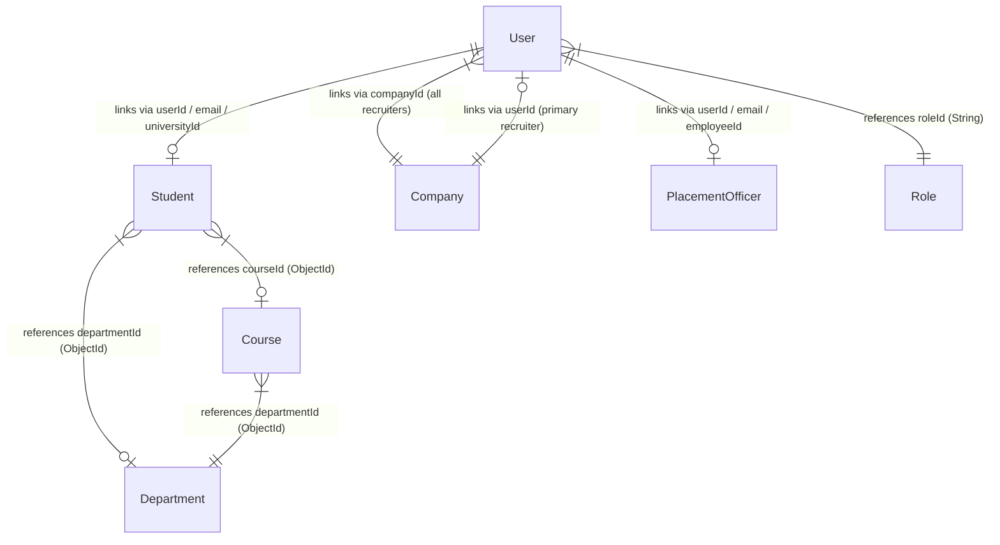

# Complete Read-Only Audit of Existing Database Collections

**Project**: VVWU Campus Recruitment Portal  
**Audit Date**: October 12, 2026 (Updated & Verified)  
**Audit Scope**: Read-only inspection of core identity, taxonomy, and profile collections (`users`, `companies`, `placement_officers`, `students`, `departments`, `courses`, `roles`, `permissions`, `user_sessions`), comparing Mongoose schemas, live MongoDB database state, backend API services/controllers/validators, seeders, and frontend UI components.

---

## 1. Database Configuration & Live Status

- **Configured Database Name**: `campus_recruitment`
- **Database Connection URI Source**: `.env` (`MONGODB_URI=mongodb://127.0.0.1:27017/campus_recruitment`)
- **Credentials Status**: Local MongoDB instance with standard authentication configuration; credentials omitted in accordance with safety rules.
- **Live Database Audit Confirmation**:
  - Live connection established to `127.0.0.1:27017/campus_recruitment`.
  - All 9 collections exist as physical MongoDB collections.

### Collection Overview & Document Counts

| Model Name | Actual MongoDB Collection Name | Document Count | Indexes Count | Primary Key Type | Mongoose Model File Path |
| :--- | :--- | :---: | :---: | :--- | :--- |
| `User` | `users` | **2** | 6 | `ObjectId` (`_id`) | `backend/src/models/user.model.js` |
| `Student` | `students` | **1** | 8 | `ObjectId` (`_id`) | `backend/src/models/student.model.js` |
| `Company` | `companies` | **0** | 4 | `ObjectId` (`_id`) | `backend/src/models/company.model.js` |
| `PlacementOfficer` | `placement_officers` | **0** | 3 | `ObjectId` (`_id`) | `backend/src/models/placement_officer.model.js` |
| `Department` | `departments` | **2** | 4 | `ObjectId` (`_id`) | `backend/src/models/department.model.js` |
| `Course` | `courses` | **1** | 5 | `ObjectId` (`_id`) | `backend/src/models/course.model.js` |
| `Role` | `roles` | **5** | 2 | `String` (`_id`) | `backend/src/models/role.model.js` |
| `Permission` | `permissions` | **44** | 3 | `String` (`_id`) | `backend/src/models/permission.model.js` |
| `UserSession` | `user_sessions` | **2** | 4 | `ObjectId` (`_id`) | `backend/src/models/user-session.model.js` |

---

## 2. Collection Audits & Field Documentation

---

### Collection 1: `users`

**Collection Name**: `users`  
**Model Name**: `User` ([`user.model.js`](file:///e:/major/campus-recruitment-system/backend/src/models/user.model.js))  
**Document Count**: 2 (`admin@example.edu` [Super Admin], `priya@uni.edu` [Student])

#### Field Specification Table

| Field Path | Data Type | Mongoose Schema Status | Default Value | Validation & Enums | Indexes / Constraints | Ref | Code Usage | DB Presence | Notes |
| :--- | :--- | :--- | :--- | :--- | :--- | :--- | :--- | :--- | :--- |
| `_id` | `ObjectId` | Auto (`_id`) | Auto `ObjectId` | Valid 24-char hex string | Primary Key (`_id_`) | Self | Core Auth & FK | Present | System generated unique identifier |
| `email` | `String` | **Required** | None | Lowercase, Trim, Valid Email | Unique (`email_1`) | None | Auth, User Mgmt, Search | Present | Primary authentication identifier |
| `passwordHash` | `String` | **Required** | None | Hashed string (`select: false`) | None | None | Auth, Password Change | Present (Redacted) | Excluded by default in queries and `toJSON` transform |
| `userType` | `String` | **Required** | None | Enum: `['STUDENT', 'COMPANY', 'PLACEMENT']` | None | None | Auth, RBAC, Nav, Forms | Present | Discriminator field for account role category |
| `roleId` | `String` | **Required** | None | Must reference active `Role._id` | Single-field (`roleId_1`) | `Role` | RBAC middleware, Permission check | Present | String key referencing dynamic Role entity |
| `universityId` | `String` | **Conditional** (Required if `userType === 'STUDENT'`) | None | Trimmed string | Sparse Unique (`universityId_1`) | None | Student creation, Auth lookup | Present in Student doc | Sparse unique index |
| `employeeId` | `String` | **Conditional** (Required if `userType === 'PLACEMENT'`) | None | Trimmed string | Sparse Unique (`employeeId_1`) | None | Placement/Admin creation, Auth lookup | Present in Super Admin doc | Sparse unique index |
| `companyId` | `ObjectId` | **Conditional** (Required if `userType === 'COMPANY'`) | None | Valid `ObjectId` | Single-field (`companyId_1`) | `Company` | Recruiter company affiliation | Absent | Links recruiter to shared company profile |
| `accountStatus` | `String` | **Required** | `'ACTIVE'` | Enum: `['ACTIVE', 'INACTIVE', 'LOCKED']` | None | None | Auth middleware, Lock/Unlock API | Present | System security and authorization control |
| `lastLoginAt` | `Date` | Optional | `undefined` | Date ISO timestamp | None | None | Auth login handler, User listing | Present | Updated upon successful token issuance |
| `failedLoginAttempts` | `Number` | Optional | `0` | Min: `0` | None | None | Auth brute-force protection | Present | Resets to 0 on successful login |
| `lockedUntil` | `Date` | Optional | `undefined` | Date ISO timestamp | None | None | Account lock service | Absent | Populated when `accountStatus === 'LOCKED'` |
| `createdAt` | `Date` | Auto (`timestamps: true`) | Auto timestamp | Date ISO timestamp | None | None | Audit, User sorting | Present | Set on document creation |
| `updatedAt` | `Date` | Auto (`timestamps: true`) | Auto timestamp | Date ISO timestamp | None | None | Audit log | Present | Set on document modification |
| `__v` | `Number` | Mongoose Version Key | `0` | Number | None | None | Internal Mongoose | Present | Version key |

*Legacy Stored Value Note*: Early seed scripts wrote an `isEmailVerified: true` property to MongoDB, but `isEmailVerified` is omitted from the active Mongoose `userSchema`. User authorization is strictly governed by `accountStatus`.

---

### Collection 2: `companies`

**Collection Name**: `companies`  
**Model Name**: `Company` ([`company.model.js`](file:///e:/major/campus-recruitment-system/backend/src/models/company.model.js))  
**Document Count**: 0 (Collection initialized with indexes)

#### Field Specification Table

| Field Path | Data Type | Mongoose Schema Status | Default Value | Validation & Enums | Indexes / Constraints | Ref | Code Usage | DB Presence | Notes |
| :--- | :--- | :--- | :--- | :--- | :--- | :--- | :--- | :--- | :--- |
| `_id` | `ObjectId` | Auto (`_id`) | Auto `ObjectId` | Valid 24-char hex string | Primary Key (`_id_`) | Self | Profile ID, FK in `User.companyId` | No docs | Document identifier |
| `companyName` | `String` | **Required** | None | Unique, Trimmed string | Unique (`companyName_1`) | None | Company CRUD, Job Posting, Recruiter UI | No docs | Legal / Display name of company |
| `industryType` | `String` | **Required** | None | Trimmed string | Single-field (`industryType_1`) | None | Company filter, Category search | No docs | Free-text industry category |
| `hrRecruiterName` | `String` | **Required** | None | Trimmed string | None | None | Recruiter contact info | No docs | Primary HR contact name |
| `email` | `String` | **Required** | None | Lowercase, Trim, Valid Email | Unique (`email_1`) | None | Recruiter notification, Duplicate check | No docs | Primary company contact email |
| `description` | `String` | Optional | `''` | Max 1000 chars (in validator) | None | None | Company profile page | No docs | Detailed company overview |
| `website` | `String` | Optional | `''` | Max 300 chars, valid URL format | None | None | Company profile header | No docs | Official website link |
| `yearEstablished` | `Number` | **Required** | None | Min: `1800`, Max: `2100` | None | None | Company profile sidebar | No docs | Founding year |
| `designation` | `String` | Optional | `''` | Max 100 chars | None | None | Recruiter profile info | No docs | Job designation of HR contact |
| `mobileNumber` | `String` | Optional | `''` | Max 50 chars | None | None | Contact info | No docs | Recruiter phone number |
| `officeAddress` | `String` | Optional | `''` | Max 500 chars | None | None | Company contact section | No docs | Physical office address |
| `userId` | `ObjectId` | Optional | `undefined` | Valid `ObjectId` | None | `User` | Primary recruiter reference | No docs | Identifies the primary recruiter account. Secondary recruiters share `companyId` on their user account |
| `createdAt` | `Date` | Auto (`timestamps: true`) | Auto timestamp | Date ISO timestamp | None | None | Audit | No docs | Set on creation |
| `updatedAt` | `Date` | Auto (`timestamps: true`) | Auto timestamp | Date ISO timestamp | None | None | Audit | No docs | Set on modification |

*Legacy Stored Value Note*: Early documentation drafts listed `verificationStatus: ['PENDING', 'VERIFIED', 'REJECTED']`. This field is absent from `company.model.js`; recruiter access is strictly governed by `users.accountStatus`.

---

### Collection 3: `placement_officers`

**Collection Name**: `placement_officers`  
**Model Name**: `PlacementOfficer` ([`placement_officer.model.js`](file:///e:/major/campus-recruitment-system/backend/src/models/placement_officer.model.js))  
**Document Count**: 0 (Collection initialized with indexes)

#### Field Specification Table

| Field Path | Data Type | Mongoose Schema Status | Default Value | Validation & Enums | Indexes / Constraints | Ref | Code Usage | DB Presence | Notes |
| :--- | :--- | :--- | :--- | :--- | :--- | :--- | :--- | :--- | :--- |
| `_id` | `ObjectId` | Auto (`_id`) | Auto `ObjectId` | Valid 24-char hex string | Primary Key (`_id_`) | Self | Officer ID | No docs | Document identifier |
| `employeeId` | `String` | **Required** | None | Unique, Trimmed string | Unique (`employeeId_1`) | None | Officer CRUD, Auth match | No docs | Staff identifier |
| `firstName` | `String` | **Required** | None | Trimmed string | None | None | Officer name display | No docs | Given name |
| `lastName` | `String` | **Required** | None | Trimmed string | None | None | Officer name display | No docs | Surname |
| `email` | `String` | **Required** | None | Lowercase, Trim, Valid Email | Unique (`email_1`) | None | Officer email, Notification | No docs | Institutional email |
| `designation` | `String` | **Required** | None | Trimmed string | None | None | Placement Cell title | No docs | Role designation |
| `role` | `String` | **Required** | None | Enum: `['ROLE_PLACEMENT_HEAD', 'ROLE_PLACEMENT_COORDINATOR']` | None | `Role` | Role assignment in officer service | No docs | Role category (Super Admin `ROLE_SUPER_ADMIN` is intentionally excluded) |
| `userId` | `ObjectId` | Optional | `undefined` | Valid `ObjectId` | None | `User` | Link to auth account | No docs | Linked `users._id` reference |
| `createdAt` | `Date` | Auto (`timestamps: true`) | Auto timestamp | Date ISO timestamp | None | None | Audit | No docs | Set on creation |
| `updatedAt` | `Date` | Auto (`timestamps: true`) | Auto timestamp | Date ISO timestamp | None | None | Audit | No docs | Set on modification |

---

### Collection 4: `students`

**Collection Name**: `students`  
**Model Name**: `Student` ([`student.model.js`](file:///e:/major/campus-recruitment-system/backend/src/models/student.model.js))  
**Document Count**: 1 (`priya@uni.edu`)

#### Field Specification Table

| Field Path | Data Type | Mongoose Schema Status | Default Value | Validation & Enums | Indexes / Constraints | Ref | Code Usage | DB Presence | Notes |
| :--- | :--- | :--- | :--- | :--- | :--- | :--- | :--- | :--- | :--- |
| `_id` | `ObjectId` | Auto (`_id`) | Auto `ObjectId` | Valid 24-char hex string | Primary Key (`_id_`) | Self | Student ID | Present | Document identifier |
| `universityId` | `String` | **Required** | None | Unique, Trimmed, Uppercase | Unique (`universityId_1`) | None | Roll/Registration No, Search | Present | Primary student identifier |
| `firstName` | `String` | **Required** | None | Trimmed string | None | None | Student name display | Present | Given name |
| `lastName` | `String` | **Required** | None | Trimmed string | None | None | Student name display | Present | Surname |
| `email` | `String` | **Required** | None | Lowercase, Trim, Valid Email | Unique (`email_1`) | None | Contact email, Account link | Present | Primary student contact email |
| `mobileNumber` | `String` | **Required** | None | Trimmed string | None | None | Contact phone number | Present | Phone number |
| `address` | `String` | Optional | `''` | Trimmed string | None | None | Profile contact details | Present | Residential address |
| `branch` | `String` | **Required** | None | Trimmed string | Compound (`branch_1_passingYear_1`) | None | Academic filter, Eligibility | Present | Preserved legacy branch name |
| `department` | `String` | **Required** | None | Trimmed string | None | None | Academic filter | Present | Preserved legacy department string |
| `departmentId` | `ObjectId` | Optional | `undefined` | Valid `ObjectId` | Single-field (`departmentId_1`), Compound (`departmentId_1_courseId_1`) | `Department` | Normalized academic link | Present | Foreign key to `departments._id` |
| `courseId` | `ObjectId` | Optional | `undefined` | Valid `ObjectId` | Single-field (`courseId_1`), Compound (`departmentId_1_courseId_1`) | `Course` | Normalized course link | Present | Foreign key to `courses._id` |
| `semester` | `Number` | **Required** | None | Min: `1`, Max: `12` | None | None | Current academic semester | Present | Semester number |
| `cgpa` | `Number` | **Required** | None | Min: `0`, Max: `10` | None | None | Academic score, Eligibility check | Present | Cumulative GPA |
| `backlogs` | `Number` | Optional | `0` | Min: `0` | None | None | Eligibility filtering | Present | Active backlog count |
| `passingYear` | `Number` | Optional | `undefined` | Min: `1990`, Max: `2100` | Compound (`branch_1_passingYear_1`) | None | Graduation year batch filter | Present | Graduation batch year |
| `userId` | `ObjectId` | Optional | `undefined` | Valid `ObjectId` | None | `User` | Foreign key to auth user | Present | Linked `users._id` reference |
| `profilePhoto` | `String` | Optional | `undefined` | Trimmed URL/Path | None | None | Profile header photo | Absent | Image URL |
| `headline` | `String` | Optional | `undefined` | Trimmed text | None | None | Profile headline | Absent | Professional headline |
| `bio` | `String` | Optional | `undefined` | Trimmed text | None | None | Student bio | Absent | Short self-description |
| `careerObjective` | `String` | Optional | `undefined` | Trimmed text | None | None | Student resume summary | Absent | Professional goal statement |
| `skills` | `[String]` | Optional | `[]` | Array of strings | None | None | Skill tags, Recruiter search | Present (`[]`) | Technical / soft skills list |
| `githubUrl` | `String` | Optional | `undefined` | Trimmed URL | None | None | Profile links | Absent | GitHub profile link |
| `linkedinUrl` | `String` | Optional | `undefined` | Trimmed URL | None | None | Profile links | Absent | LinkedIn profile link |
| `portfolioUrl` | `String` | Optional | `undefined` | Trimmed URL | None | None | Profile links | Absent | Personal website link |
| `isPublicProfile` | `Boolean` | Optional | `true` | Boolean | Single-field (`isPublicProfile_1`) | None | Visibility access control | Present | Profile privacy toggle |
| `resume` | `Object` | Optional | `undefined` | `resumeSchema` (No `_id`) | None | None | Resume download API | Absent | Embedded object |
| `certificates` | `[Object]` | Optional | `[]` | Array of `certificateSchema` | None | None | Student certificates CRUD | Present (`[]`) | Sub-document array |
| `projects` | `[Object]` | Optional | `[]` | Array of `projectSchema` | None | None | Student projects CRUD | Present (`[]`) | Sub-document array |
| `internships` | `[Object]` | Optional | `[]` | Array of `internshipSchema` | None | None | Student internships CRUD | Present (`[]`) | Sub-document array |
| `achievements` | `[Object]` | Optional | `[]` | Array of `achievementSchema` | None | None | Student achievements CRUD | Present (`[]`) | Sub-document array |
| `createdAt` | `Date` | Auto (`timestamps: true`) | Auto timestamp | Date ISO timestamp | None | None | Audit | Present | Set on creation |
| `updatedAt` | `Date` | Auto (`timestamps: true`) | Auto timestamp | Date ISO timestamp | None | None | Audit | Present | Set on modification |

---

## 3. Nested Sub-schemas (`students` Collection)

The `Student` model defines 5 nested sub-schemas for rich portfolio tracking:

### 3.1 `resumeSchema` (Embedded Object, `_id: false`)
- `url`: `String` (**Required**) — Relative file path (`/uploads/resumes/...`).
- `fileName`: `String` (**Required**) — Original filename.
- `fileSize`: `Number` (Optional) — File size in bytes.
- `uploadedAt`: `Date` (Default: `Date.now`) — Timestamp of upload.

### 3.2 `certificateSchema` (Embedded Sub-document Array with `_id` & `timestamps`)
- `name`: `String` (**Required**, trim) — Certificate title.
- `issuingOrganization`: `String` (**Required**, trim) — Certification authority.
- `issueDate`: `String` (Optional, trim) — Date issued.
- `credentialId`: `String` (Optional, trim) — Certificate ID/code.
- `credentialUrl`: `String` (Optional, trim) — Verification link.
- `fileUrl`: `String` (Optional, trim) — Document attachment path.

### 3.3 `projectSchema` (Embedded Sub-document Array with `_id` & `timestamps`)
- `title`: `String` (**Required**, trim) — Project name.
- `description`: `String` (Optional, trim) — Project details.
- `technologies`: `[String]` (Default: `[]`) — Technology stack tags.
- `projectUrl`: `String` (Optional, trim) — Live demo link.
- `githubUrl`: `String` (Optional, trim) — Source code repository.
- `startDate`: `String` (Optional, trim) — Start date.
- `endDate`: `String` (Optional, trim) — Completion date.

### 3.4 `internshipSchema` (Embedded Sub-document Array with `_id` & `timestamps`)
- `organization`: `String` (**Required**, trim) — Company/Organization name.
- `role`: `String` (**Required**, trim) — Internship designation.
- `description`: `String` (Optional, trim) — Key responsibilities.
- `startDate`: `String` (Optional, trim) — Start date.
- `endDate`: `String` (Optional, trim) — End date.
- `documentUrl`: `String` (Optional, trim) — Certificate / completion letter link.

### 3.5 `achievementSchema` (Embedded Sub-document Array with `_id` & `timestamps`)
- `title`: `String` (**Required**, trim) — Honor / Award title.
- `description`: `String` (Optional, trim) — Details.
- `date`: `String` (Optional, trim) — Award date.
- `issuingOrganization`: `String` (Optional, trim) — Issuing body.
- `documentUrl`: `String` (Optional, trim) — Certificate / proof attachment path.

---

## 4. Complete Verified Indexes Registry Across All Collections

| Collection Name | Index Name | Indexed Fields | Options | Live DB Status |
| :--- | :--- | :--- | :--- | :---: |
| `users` | `_id_` | `{ _id: 1 }` | `unique: true` | Verified |
| `users` | `email_1` | `{ email: 1 }` | `unique: true` | Verified |
| `users` | `roleId_1` | `{ roleId: 1 }` | Standard | Verified |
| `users` | `universityId_1` | `{ universityId: 1 }` | `unique: true, sparse: true` | Verified |
| `users` | `employeeId_1` | `{ employeeId: 1 }` | `unique: true, sparse: true` | Verified |
| `users` | `companyId_1` | `{ companyId: 1 }` | Standard | Verified |
| `students` | `_id_` | `{ _id: 1 }` | `unique: true` | Verified |
| `students` | `universityId_1` | `{ universityId: 1 }` | `unique: true` | Verified |
| `students` | `email_1` | `{ email: 1 }` | `unique: true` | Verified |
| `students` | `branch_1_passingYear_1` | `{ branch: 1, passingYear: 1 }` | Compound | Verified |
| `students` | `isPublicProfile_1` | `{ isPublicProfile: 1 }` | Standard | Verified |
| `students` | `departmentId_1` | `{ departmentId: 1 }` | Relational | Verified |
| `students` | `courseId_1` | `{ courseId: 1 }` | Relational | Verified |
| `students` | `departmentId_1_courseId_1` | `{ departmentId: 1, courseId: 1 }` | Compound | Verified |
| `companies` | `_id_` | `{ _id: 1 }` | `unique: true` | Verified |
| `companies` | `companyName_1` | `{ companyName: 1 }` | `unique: true` | Verified |
| `companies` | `email_1` | `{ email: 1 }` | `unique: true` | Verified |
| `companies` | `industryType_1` | `{ industryType: 1 }` | Standard | Verified |
| `placement_officers` | `_id_` | `{ _id: 1 }` | `unique: true` | Verified |
| `placement_officers` | `employeeId_1` | `{ employeeId: 1 }` | `unique: true` | Verified |
| `placement_officers` | `email_1` | `{ email: 1 }` | `unique: true` | Verified |
| `departments` | `_id_` | `{ _id: 1 }` | `unique: true` | Verified |
| `departments` | `code_1` | `{ code: 1 }` | `unique: true` | Verified |
| `departments` | `name_1` | `{ name: 1 }` | Standard | Verified |
| `departments` | `isActive_1` | `{ isActive: 1 }` | Standard | Verified |
| `courses` | `_id_` | `{ _id: 1 }` | `unique: true` | Verified |
| `courses` | `code_1` | `{ code: 1 }` | `unique: true` | Verified |
| `courses` | `departmentId_1` | `{ departmentId: 1 }` | Relational | Verified |
| `courses` | `level_1` | `{ level: 1 }` | Standard | Verified |
| `courses` | `isActive_1` | `{ isActive: 1 }` | Standard | Verified |
| `roles` | `_id_` | `{ _id: 1 }` | `unique: true` | Verified |
| `roles` | `name_1` | `{ name: 1 }` | `unique: true` | Verified |
| `permissions` | `_id_` | `{ _id: 1 }` | `unique: true` | Verified |
| `permissions` | `name_1` | `{ name: 1 }` | `unique: true` | Verified |
| `permissions` | `module_1` | `{ module: 1 }` | Standard | Verified |
| `user_sessions` | `_id_` | `{ _id: 1 }` | `unique: true` | Verified |
| `user_sessions` | `userId_1` | `{ userId: 1 }` | Standard | Verified |
| `user_sessions` | `sessionTokenHash_1` | `{ sessionTokenHash: 1 }` | `unique: true` | Verified |
| `user_sessions` | `expiresAt_1` | `{ expiresAt: 1 }` | `expireAfterSeconds: 0` (TTL) | Verified |

---

## 5. Entity Relationship Matrix & Approved Topology

### Relationship Design Rationales
1. **Multi-Recruiter Architecture**:
   - `companies.userId` explicitly designates the **primary recruiter** responsible for the profile and corporate point of contact.
   - `users.companyId` connects any recruiter (primary or secondary) to that company profile.
   - Step 1 fix guarantees that deleting secondary recruiters preserves the company profile, while deleting the primary recruiter reassigns `companies.userId` to a remaining active recruiter.
2. **Super Admin / Placement Officer Relationship**:
   - Super Admin is an institution administrator account (`roleId: 'ROLE_SUPER_ADMIN'`, `userType: 'PLACEMENT'`) and has no corresponding record in `placement_officers`.
   - `PlacementOfficer` records are strictly reserved for Placement Cell staff (`ROLE_PLACEMENT_HEAD`, `ROLE_PLACEMENT_COORDINATOR`).
3. **Student Academic Taxonomy Transition**:
   - `students.department` and `students.branch` strings are preserved for backwards compatibility and Excel bulk import templates.
   - `students.departmentId` and `students.courseId` ObjectIds provide normalized relational linkage to frozen `Department` and `Course` entities.

---

## 6. Current State Summary

- **Database Architecture**: All 9 collections verified against Mongoose models and active MongoDB database.
- **Stored State**: 2 active user accounts (`admin@example.edu` as Super Admin, `priya@uni.edu` as Student), 1 student record, 2 departments, 1 course, 5 roles, 44 canonical permissions, and 2 active sessions.
- **Read-Only Status**: Audit verified with zero modifications to application source code, schemas, indexes, or database records.
